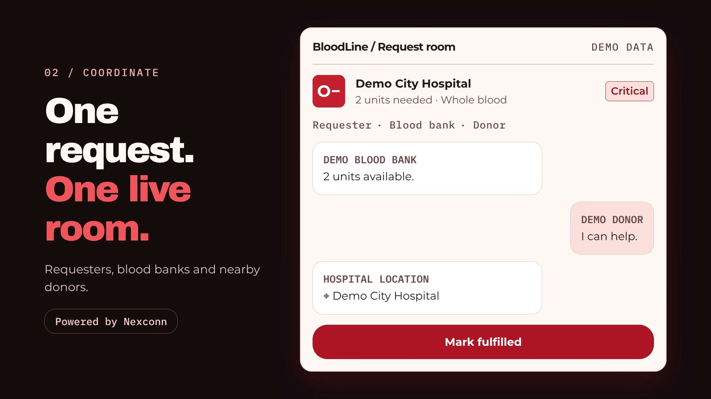

# BloodLine

**One blood request. One shared chat room.**

BloodLine connects requesters, nearby donors and blood banks so they can coordinate
an urgent blood request in one place. Built for a one-day hackathon with Flutter,
Go, SQLite and the Nexconn Chat SDK.

[Launch film](brag-output/brag.mp4) · [API reference](docs/API.md) · [Deployment guide](deploy/README.md)

[](brag-output/brag.mp4)

*Launch-film artwork uses fictional data and recreated app screens.
[Editable source and credits](brag-output/README.md).*

## How it works

1. A requester selects a blood group, component, units, hospital and urgency.
2. The API matches blood banks with suitable stock and nearby donors, then creates
   a Nexconn group channel for the request.
3. Donors and banks accept to join the conversation. Participants coordinate
   through messages, photos and location pins.
4. The requester marks the request fulfilled; the room becomes read-only.

| Role | What you can do |
|---|---|
| Requester | Broadcast and track requests, coordinate in chat and close a request |
| Donor | See matching requests, join a room, manage your profile and record a donation |
| Blood bank | Update stock by blood group and component, view nearby requests and join coordination |

Matching uses stock, blood group, component and distance. The default donor radius
is 10 km. Whole-blood and red-cell requests currently use exact blood-group
matching; plasma, cryo and platelets use component-specific compatibility and
require donors to opt into apheresis. See the [matching rules](docs/DATA_MODEL.md#matching-component-aware-live-path).

## Project status

This is a hackathon demo. Authentication uses a fixed demo OTP (`123456` by
default), without SMS delivery or real identity verification. The hospital picker
contains sample entries. Use fictional information when trying the demo.

The request, chat and fulfillment flow has been checked on a physical Android
phone with live Nexconn. The [verification handoff](docs/handoff/codex.md) records
the checks and their limits. Automated checks cover the Go API, Flutter widgets
and Dart-to-Go HTTP integration.

Android signing and release scripts are included, but no GitHub Release is
published yet. Follow the [Android build and deployment guide](deploy/README.md)
to prepare an installable APK and its API service. Temporary demo tunnels require
the host computer to remain online.

## Architecture

```text
Flutter app (requester / donor / blood bank)
  ├── REST ──> Go API ──> SQLite
  │               └──> Nexconn server API (Singapore)
  └── Nexconn Chat SDK + Chat UI ──> request conversations
```

The API controls matching, authentication and room membership. Each request stores
one `channel_id`. Nexconn server credentials stay on the API; the app receives a
user chat token and uses the Singapore SDK region (`AreaCode.sg`).

| Layer | Stack |
|---|---|
| Mobile | Flutter / Dart, Provider, Nexconn Chat SDK and Chat UI |
| API | Go 1.22+, standard-library `net/http`, JWT authentication |
| Storage | SQLite via `modernc.org/sqlite`; migrations run on startup |
| Distribution | Signed Android APK tooling; containerized API with persistent storage |

## Run locally

Prerequisites: Git, Go 1.22+, and Flutter with Dart compatible with
[`app/pubspec.yaml`](app/pubspec.yaml) (`^3.14.0`). Android builds also need Java
17+ and the Android SDK.

```sh
git clone https://github.com/abhayharne/bloodline.git
cd bloodline
```

### API without Nexconn credentials

From the repository root:

```sh
cd api
JWT_SECRET=local-demo-only-change-me NEXCONN_FAKE=1 DEV=0 \
  SEED_ON_EMPTY=1 DB_PATH=./bloodline-local.db go run ./cmd/server
```

In another terminal:

```sh
curl http://localhost:8080/health
# {"status":"ok"}
```

This mode exercises the API using an in-memory fake chat service. It does not
provide real device-to-device messaging. Startup seeding adds fictional accounts
and stock only when the database is entirely empty; create requests through the
API or app so they receive a room.

### API with live chat

Copy `.env.example` to `.env` at the repository root **if you do not already have
one**. Set a private `JWT_SECRET`, your Nexconn app key and secret, and the two
Singapore API base URLs. The server finds `.env` automatically. Keep
`NEXCONN_FAKE`, `NEXCONN_MOCK` and `DEV` disabled for a shared demo.

```sh
cd api
go run ./cmd/server
```

The default port is `8080`. See [configuration](docs/API.md#configuration-environment)
for database paths, feature flags and matching radius. Private development resets
require both `DEV=1` and `DEV_KEY`, with a matching `X-Dev-Key` request header.

### Flutter app

In another terminal, from the repository root:

```sh
cd app
flutter pub get
flutter run \
  --dart-define=API_BASE=http://10.0.2.2:8080 \
  --dart-define=NEXCONN_APP_KEY=YOUR_NEXCONN_APP_KEY
```

`10.0.2.2` reaches the host API from the Android emulator. For a physical phone,
use the computer's LAN IP on the same network or a reachable HTTPS API URL.
The app key must belong to the same Nexconn project as the API credentials.
The app uses the demo OTP above unless the server configuration changes it.

## Verification

Run from the repository root:

```sh
scripts/gate-api.sh
scripts/gate-app.sh
```

The API gate builds, vets, runs race-enabled tests and exercises the request
lifecycle with optional features disabled and enabled. Smoke tests use a temporary
database, a random port and fake Nexconn. The app gate resolves dependencies,
analyzes Dart and runs tests, including an isolated Go-backed HTTP suite; both
Flutter and Go must be on `PATH`.

## Repository guide

| Path | Contents |
|---|---|
| [`app/`](app/) | Flutter application and local Nexconn Chat UI package |
| [`api/`](api/) | Go server, SQLite schema, matching logic and tests |
| [`deploy/`](deploy/) | Container, environment template and Android release guide |
| [`scripts/`](scripts/) | Verification gates, smoke tests and release tooling |
| [`brag-output/`](brag-output/) | Launch film, preview artwork and editable source |
| [Architecture](docs/ARCHITECTURE.md) | System boundaries and request flow |
| [API contract](docs/API.md) | Endpoints, authentication and configuration |
| [Data model](docs/DATA_MODEL.md) | Tables, compatibility and matching rules |
| [Demo script](docs/DEMO_SCRIPT.md) / [pitch](docs/PITCH.md) | Presentation material |
| [Plan](docs/PLAN.md) / [decisions](docs/DECISIONS.md) | Scope, task status and design decisions |

For agent-assisted development, read [AGENTS.md](AGENTS.md) and the relevant
[handoff](docs/handoff/) before changing code. Keep `.env`, databases, signing
keys and private runtime logs out of Git.
